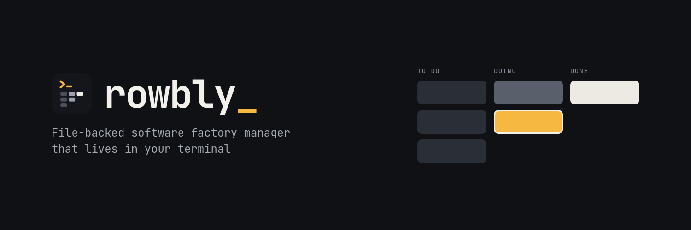

<p align="center">
  
</p>

<p align="center">
  <a href="https://github.com/sgolovine/rowbly/actions/workflows/ci.yml"></a>
  <a href="https://www.npmjs.com/package/rowbly"></a>
  <a href="https://www.npmjs.com/package/rowbly"></a>
  <a href="https://github.com/sgolovine/rowbly/blob/main/LICENSE.md"></a>
</p>

<p align="center"><a href="https://rowbly.com"><strong>rowbly.com</strong></a></p>

# Rowbly

Rowbly keeps a Kanban board in Markdown and JSON files in your repository.
Its native factory starts independent Pi workers from fixed policy rules, with no supervisor model. Each worker has a Story, a worktree and a separate conversation.
The terminal UI and CLI use the same services.

## Prerequisites

Rowbly must run on Node >=22.19.0. Native factory execution must use Linux, Git, local files and util-linux `flock`.
You can use the board and read-only history without provider credentials.
Other platforms have no native execution guarantee.
The factory can run workers on worker hosts over SSH. See [Remote worker hosts](#remote-worker-hosts).
Shared runtime folders, NFS and copied runtime folders are not supported. The daemon ownership has no guarantee across machines.

## First start

1. Install Rowbly:

   ```sh
   npm install -g rowbly
   ```

2. Open a terminal in your repository.
3. Run `rowbly` to create a Project through the TUI.

4. Select defaults or customize the name, Stages, skills and harnesses.
5. Press `?` to see the keys.

Use `npx rowbly` without a global install. Use `rowbly init` for the CLI setup questions.
Agents can use `rowbly init --defaults --harness codex` without interactive questions.
Replace `codex` with the correct harness ID from the table below.

Run `rowbly doctor` to examine the Project files. Run `rowbly --help` to see the commands.

## Provider sign-in and models

1. Run `rowbly auth providers` to see provider IDs and login methods.
2. Run `rowbly auth login` in an interactive terminal.
3. Select a provider and follow its account or API-key prompts.
4. Run `rowbly model list` to see configured models and supported thinking levels.
5. Set the worker model and the worker limit:

   ```sh
   rowbly factory configure --worker <provider/model> --max-workers 4
   ```

`--worker-thinking` selects a supported thinking level for the workers.
Without an explicit choice, Pi selects a default model. Rowbly does not change global Pi settings.
Factory preferences stay in the `factory` key of `.rowbly/rowbly.config.json`. Credentials stay in Pi
storage, outside the Project.

API keys use masked prompts. Do not put secrets in command arguments or Project files.
`rowbly auth status` reports configured status, without a health check.
A model list does not prove provider access, quota or credential health.
Use `rowbly auth logout <provider>` to remove a stored credential.

In the TUI, open Settings and select AI in the Factory group. The section has three tabs: Providers,
Models and Limits. Use `←` and `→` to change the tab.

- **Providers** shows the signed-in providers. The `d` key signs out with confirmation, and `r` reloads.
  The `n` key opens a page with the other providers. On that page, Enter signs in and Escape goes back.
- **Models** shows the worker model. The `w` key changes it. The picker
  offers supported thinking levels and `Pi default`.
- **Limits** shows the worker limit. The `l` key edits it.

Escape cancels sign-in and returns focus.

## Factory controls

1. Create a Story and put it in a Stage whose prompt gives an agent work.
2. Press `f` to open Factory controls.
3. Press `s` to start the native factory.

The header shows Factory status and worker counts when space permits.
Factory controls show the worker counts, queue reasons, provider pauses and attention items.
The `h` key opens the old supervisor Threads. The `a` key opens the AI section of Settings.

The factory runs in a separate daemon. Close the TUI to leave the factory active.

The same controls are available through the CLI:

```sh
rowbly factory start
rowbly factory status
rowbly factory logs --tail 20
rowbly factory stop
rowbly factory restart
```

Use `rowbly factory start --foreground` to run in the current terminal.
Native execution must use a Git repository. Workers preserve existing branch work and dirty worktrees.
The factory makes no model call when no worker runs. Use `rowbly factory release <story-id>` to release a parked Story.

A Project without `state.json` remains valid and shows no activity status line below the Story list.

## Prompts

Each factory agent gets the Rowbly system prompts first. Then it gets the prompts of your Project:

| File                        | Prompt         | Who gets it                    |
| --------------------------- | -------------- | ------------------------------ |
| `.rowbly/prompts/SYSTEM.md` | Project prompt | All workers                    |
| `.rowbly/prompts/WORKER.md` | Worker prompt  | All workers, in all Stages     |
| `.rowbly/stages/<KEY>.md`   | Stage prompt   | Only the workers of that Stage |

The Rowbly system prompts have the highest priority. Your prompts cannot remove a system rule.
After the system prompts, the Stage prompt comes first, then the Worker prompt, then the Project prompt.

Edit a prompt in the file, in Settings › Project › Prompts, or with the CLI:

```sh
rowbly prompt list
rowbly prompt get worker
rowbly prompt set worker --file worker-prompt.md
```

`rowbly init` creates the two files with no text. A missing file has no text.
`rowbly doctor --fix` creates a missing prompt file.
Rowbly does not read the old `.rowbly/ROWBLY.md` now. `rowbly doctor --fix` moves its text to `prompts/SYSTEM.md` when that prompt has no text.

## Threads and conversations

Press `t`, or click the `Stories`/`Threads` Switch in the header, to see the worker Threads of all Stories.
The Factory view shows the sections "Active Threads" and "Inactive Threads". The Stage sidebar filters the Threads.
Press `enter` on a Thread to see its metadata and its conversation.

Open a Story and select its Threads tab. The tab shows active and historical worker attempts.
A pending Thread is a durable reservation that occupies a worker slot.
A Story that waits for capacity has a queue note, without a fictitious Thread.
Select a Thread to read its conversation without agent activation.

Use `x` to interrupt with confirmation. Use `r` to resume an eligible Thread through the active factory.

The viewer supports arrows, `j`/`k`, Page Up, Page Down, Home, End and the mouse wheel.
Scroll up to stop follow. Press End or `f` to follow again. Escape returns to the previous view.

Only finalized Pi messages appear. Unknown session formats show a placeholder.
Read-only history works while the factory is off.

```sh
rowbly thread list --story APP-01
rowbly thread show <id>
rowbly thread log <id> --tail 20
rowbly thread cancel <id>
rowbly thread release <id>
rowbly thread resume <id>
rowbly thread steer <id> --message "Use the new API"
```

`thread release` stops a worker on a worker host as a cancel, but the Story does not wait for the
user or for that host. The factory can then start a new worker for the Story.

`thread log` has a maximum of 100 entries. Metadata lists do not load transcripts.
Conversation reads use bounded pages from the selected current-format Pi history.
Thread history stays after a Story is deleted.

## Stop, resume and recovery

Press `x` in Factory controls and confirm to stop. The CLI equivalent is `rowbly factory stop`.
Normal stop aborts Pi sessions and preserves histories and worktrees.
Start again to let the factory start new workers for eligible Stories. A start does not automatically resume every Thread.

Before an explicit resume, make sure that these conditions apply:

- The factory is active.
- The Story is in the original Stage.
- The Thread has a session file.
- The policy permits the resume.
- The original worktree is present.

Completed Threads cannot resume. Each Thread has at most three runs; retries create new Threads.
Cancellation holds the Story and Stage until release, explicit resume or a material Story change.

After definite daemon death, recovery marks active runs interrupted and repairs missing native state projections.
An old heartbeat does not prove death. Live or uncertain owners prevent takeover.
Shell descendants started by a crashed daemon are not tracked. Normal stop relies on Pi abort for shell children.

Do not assume exactly-once shell effects. Examine uncertain external effects before a resume.
Stop all relevant factory processes before offline repair of a lifecycle guard left after a crash.
See [runtime files and locks](docs/architecture/native-factory/runtime-and-locks.md) and
[recovery](docs/architecture/native-factory/recovery.md) for the lock contract and recovery limits.

## Remote worker hosts

The factory can run workers on other Linux machines over SSH. The factory manager and the board stay on your machine.
A remote worker writes its Story changes to a copy. Your machine applies them to the board.

Each worker host must have these items:

- Linux, Git and util-linux `flock`.
- Node 22.19.0 or later. `node` and `npm` must be on the `PATH` of a non-interactive SSH session.
- SSH access from your machine with a key and without a password.

Add the host. Rowbly installs the same Rowbly version on the host:

```sh
rowbly host add ws1 --ssh user@ws1.lan --max-workers 2
```

Log in on the host. Rowbly does not send credentials over SSH:

1. Run `rowbly host login ws1` to log in to Pi on the host.
2. On the host, run `gh auth login`.
3. On the host, give Git push access to the repository.
4. On the host, set the Git identity (`user.name` and `user.email`).

SSH agent forwarding is not sufficient, because a remote worker continues after a disconnect.

Turn the host on for the current Project. Then check the host:

```sh
rowbly host use ws1
rowbly host check ws1
```

`host use` clones the `origin` repository into a managed folder on the host.
Use `--path <dir>` to use an existing clean clone of the same repository.
`host check` shows a checklist with an action for each item that fails.

Set the placement of new workers:

```sh
rowbly factory configure --placement prefer-local
```

The policies are `prefer-local` (the default), `most-free` and `prefer-remote`.
You can also set the placement in the Hosts section of Settings.

When a host disconnects, its workers continue on the host. The Factory controls show the state of the host.
The Threads of the host show `connection lost` in the TUI, in `rowbly thread list` and in `rowbly status`.
The host gets no new work until it connects again. Then your machine applies the changes of its workers.

When you cancel a remote Thread while its host is offline, the Thread becomes abandoned.
Its later changes are held. They do not go to the board automatically.
Apply or discard them with the CLI, or with `a` or `d` in the Threads tab of the Story:

```sh
rowbly thread held <id>
rowbly thread held <id> --apply
rowbly thread held <id> --discard
```

Use these commands to change or remove a host:

```sh
rowbly host update ws1 --max-workers 4
rowbly host update ws1 --disable
rowbly host unuse ws1
rowbly host remove ws1
```

`host unuse` and `host remove` refuse while a Thread on the host is active. The clone and the worktrees stay on the host.
See [remote worker hosts](docs/architecture/native-factory/remote-hosts.md) for the details.

## Files and compatibility

Stories, Stage prompts, Specs and user prompts remain ordinary files under `.rowbly/`.
Existing Projects need no migration. Without factory settings, the worker limit is four.
`.rowbly/.gitignore` excludes `/state.json*` and `/runtime/`.
The native factory writes v1 `state.json`; unknown v1 keys stay intact.

Runtime metadata, command receipts, operational logs and Pi histories stay in `.rowbly/runtime/`.
Do not commit runtime files or credentials. Doctor reports tracked runtime files and corrupt or orphan Threads.
`rowbly doctor --fix` can add missing ignore rules. It does not repair conversations.

Rowbly does not bundle an external factory skill now. A Project can still have an old installed copy of the `factory` skill.
Never run that copy and the native factory together. Old copies do not honor the native ownership protocol.
Stop external workers before `rowbly factory start --adopt-external` marks their active attempts interrupted.
That option does not stop external workers or import their conversations.

| Path                    | Support and limits                                                                          |
| ----------------------- | ------------------------------------------------------------------------------------------- |
| Existing Projects       | No Story, Stage, Spec or config migration. Missing runtime files remain valid.              |
| Native execution        | Linux, Git, local files and util-linux `flock`; minimum Node 22.19.0.                       |
| Old external supervisor | No longer bundled; old copies cannot protect native ownership.                              |
| Peek                    | Current Pi v3 only; unknown versions show a placeholder; no agent activation.               |
| Recovery                | Definite local owner death only; no shell descendant tracking after a daemon crash.         |
| Worker hosts            | Linux over SSH, through the host agent only; no shared, NFS or copied runtime folders.      |
| Authentication evidence | Faux and scripted tests; real login, entitlement and refresh need separate live validation. |

## Skills

| Skill     | Function                                                              |
| --------- | --------------------------------------------------------------------- |
| `refine`  | Makes a Story ready for development without source code changes.      |
| `develop` | Builds a refined Story in a Git worktree, or repairs review findings. |
| `review`  | Examines a Story pull request and reports if it is ready to merge.    |

The default Stage prompts tell the workers to use these skills. Install the skills for the harness of your workers:

```sh
rowbly skill install develop --harness claude-code --harness codex
```

| Harness          | Project skills folder |
| ---------------- | --------------------- |
| `claude-code`    | `.claude/skills`      |
| `codex`          | `.agents/skills`      |
| `gemini-cli`     | `.gemini/skills`      |
| `github-copilot` | `.github/skills`      |
| `cursor`         | `.cursor/skills`      |

Run `rowbly skill list` to see installed skills. Run `rowbly skill remove` to remove a skill.
Keep local changes to an installed skill in a different place. Removal deletes the tracked folder and its local changes.

## Development and validation

Rowbly uses TypeScript, Commander.js, Ink and the pinned Pi SDK 1.5.2. It uses pnpm as the package manager.
The repository is a pnpm workspace: `packages/cli/` is the `rowbly` package, and `packages/website/` is the website. Run the commands below from the root of the repository.
Pi loads on demand for authentication, model selection and native execution.
The board, help, doctor, factory status, metadata and read-only history paths do not import Pi runtime values.

```sh
git clone https://github.com/sgolovine/rowbly.git
cd rowbly
pnpm install
pnpm dev
```

Run these checks before a change is complete:

```sh
pnpm lint
pnpm typecheck
pnpm test
pnpm build
```

Automated session tests use Pi's faux provider, in-memory credentials and no live provider requests.
Daemon tests isolate HOME and Pi directories and block network access.
These tests do not prove real provider entitlement, browser login or token refresh.
Live provider validation is separate. See [AGENTS.md](AGENTS.md) for contribution rules, and
[docs/architecture](docs/architecture/README.md) for the architecture.

## License

Rowbly uses the [MIT License](LICENSE.md).
