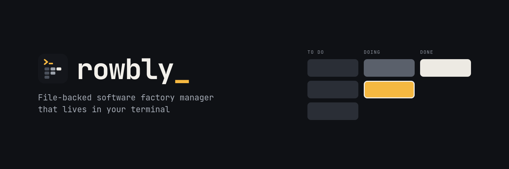
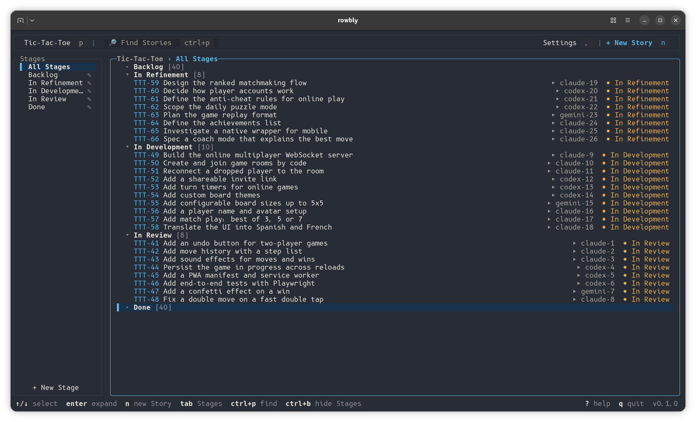

<p align="center">
  
</p>

<p align="center">
  <a href="https://github.com/sgolovine/rowbly/actions/workflows/ci.yml"></a>
  <a href="https://www.npmjs.com/package/rowbly"></a>
  <a href="https://github.com/sgolovine/rowbly/releases/latest"></a>
  <a href="https://www.npmjs.com/package/rowbly"></a>
  
  <a href="https://github.com/sgolovine/rowbly/blob/main/LICENSE.md"></a>
</p>

<p align="center">
  <strong>Give your coding agents a board. Keep the board in your repo.</strong>
</p>

## Intro

Rowbly is a Kanban board for you and your coding agents. It lives in your repository, and it opens in your terminal.

Agents do their best work when they know what to do next. With Rowbly, you write a story and put it in a stage. The stage tells the agent what to do with that story. You watch the work move across the board.

Rowbly has no server, no account and no database. Your board is a folder of Markdown files, so it stays with your code in Git. You can read each file, change each file and examine each change in a pull request.

You use the terminal UI. Your agents use the CLI. Both change the same files, so you always see the same board.

<p align="center">
  
</p>

## Installation

Rowbly runs on Node 22 or later. Install it from npm:

```sh
npm install -g rowbly
```

Go to your project and create a board:

```sh
cd my-project
rowbly init
```

Every new project starts with two stages, **Backlog** and **Done**. Add your first story, then open the board:

```sh
rowbly create-story --title "Add a login page"
rowbly
```

Press `?` in the terminal UI to see all the keys. Run `rowbly --help` to see all the commands.

## Features

- **Board in plain files.** Each story is a Markdown file in your repository.
- **Prompts for each stage.** Tell your agents what to do with a story in each stage.
- **Custom fields.** Add the data that your project wants on each story.
- **Skills that are ready for use.** Install the factory, refine, develop and review skills in your project.

## Skills

Rowbly comes with four skills that teach your agent a full development process:

| Skill     | What it does                                                                    |
| --------- | ------------------------------------------------------------------------------- |
| `refine`  | Makes a story ready for development. It writes no code.                         |
| `develop` | Builds a refined story in a Git worktree, or fixes the findings of a review.    |
| `review`  | Examines the pull request of a story and reports if the work is ready to merge. |
| `factory` | Watches your stories and starts a worker when a story changes stage.            |

Use one skill by itself, or use all four as a software factory. Put stories on the board, and the factory starts the correct worker for each stage.

Install a skill for one or more harnesses:

```sh
rowbly install-skill factory --harness claude-code --harness codex
```

| Harness          | Project skills folder |
| ---------------- | --------------------- |
| `claude-code`    | `.claude/skills`      |
| `codex`          | `.agents/skills`      |
| `gemini-cli`     | `.gemini/skills`      |
| `github-copilot` | `.github/skills`      |
| `cursor`         | `.cursor/skills`      |

Run `rowbly list-skills` to see the installed skills. Run `rowbly remove-skill` to remove a skill.

Keep your changes to an installed skill in a different place. `rowbly remove-skill` deletes the folder and all local changes in it.

## Development

Rowbly uses TypeScript, [Commander.js](https://github.com/tj/commander.js) and [Ink](https://github.com/vadimdemedes/ink). It uses [pnpm](https://pnpm.io) as the package manager.

```sh
git clone https://github.com/sgolovine/rowbly.git
cd rowbly
pnpm install
pnpm dev              # run the terminal UI from source
pnpm dev --help       # run the CLI from source
pnpm link --global    # put your local build on your PATH
```

Run these checks before you send a change:

```sh
pnpm lint
pnpm typecheck
pnpm test
pnpm build
```

Read [`AGENTS.md`](https://github.com/sgolovine/rowbly/blob/main/AGENTS.md) for the architecture, the conventions and the rules for the TUI design system.

## License

Rowbly is free software under the [MIT License](https://github.com/sgolovine/rowbly/blob/main/LICENSE.md).
