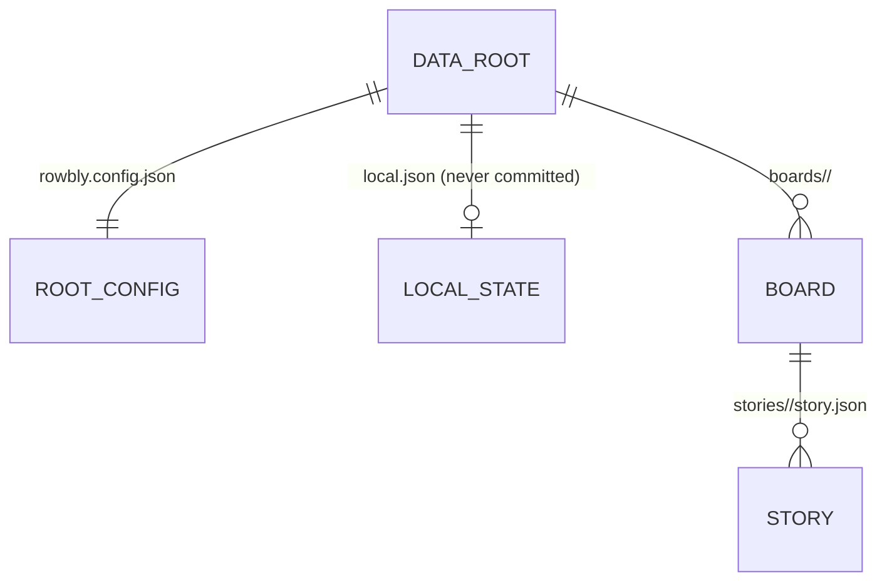

# Data model

Everything Rowbly knows is in the Data Root, a `.rowbly/` folder of JSON and Markdown files. The exact meaning of each term is in the [glossary](../agents/CONTEXT.md).

## Records and how they relate



- There is no container between the Data Root and a Board ([ADR-0007](../agents/adr/0007-no-workspaces.md)).
- Stages and Custom Fields are **configuration**, not records: ordered lists in the [Configuration Cascade](#configuration-cascade), with no ids of their own ([ADR-0005](../agents/adr/0005-stages-and-fields-are-configuration.md)).
- Assignees, Tasks, Epics, Specs, Comments and Story Linking are not core. They are [Built-in Plugins](../plugins/built-in.md) that keep Plugin Data on these records and Plugin files beside them.

## Layout

```text
.rowbly/
  rowbly.config.json            # optional Stages / Custom Fields, Plugin entries
  local.json                    # Local State: current Board and the local Me; never committed
  .gitignore                    # local.json, .lock, .lock.break, .txn/
  .lock, .lock.break, .txn/     # the lock and the commit journal (see storage.md); never committed
  plugins/<id>/…                # Plugin files for the whole Data Root (Epics, the Assignee roster)
  boards/<board>/
    board.config.json           # the Board record, optional Stages / Custom Fields, Board Plugin settings
    plugins/<id>/…              # Plugin files for this Board (Board Specs)
    stories/<KEY>/
      story.json                # one Story, with its bags (e.g. its Tasks)
      plugins/<id>/…            # Plugin files for this Story (Story Specs)
```

Each Story is its own folder, so most changes touch one small file and merge cleanly. Every record file carries `version: 1`. A record whose `version` is not 1 is not read and not written.

The [Home Config](#home-config), `~/.rowblyrc.json`, sits outside every Data Root.

## Records

The schemas are in `src/schemas/`. Every record may also carry Plugin Data under `plugins` ([below](#plugin-data-and-plugin-files)).

| Record | File | Holds |
| --- | --- | --- |
| Root config (`RowblyConfig`) | `rowbly.config.json` | optional `stages` and `customFields`, and `plugins`: one entry per Plugin, `{ "enabled": true, …settings }` |
| Local State | `local.json` | optional `board` (the current Board) and `me` (the local Me, a handle) |
| Board (`BoardConfig`) | `boards/<id>/board.config.json` | `id` (the folder's slug), `name`, `description`, `keyPrefix`, optional `stages` and `customFields`, timestamps |
| Story | `boards/<id>/stories/<KEY>/story.json` | `key`, `boardId`, `name`, `description` (Markdown), `stage`, `rank`, `priority` (`P0`–`P4` or `null`), `labels`, `dueDate`, `customFields`, `createdBy`, timestamps |

### Identity

- **Board:** a lower-kebab-case slug, which is also its folder name. Its `keyPrefix` is unique in the Data Root, so a Story Key alone names its Board.
- **Story Key:** the Board's key prefix and a number (`WEB-42`), which is also the Story's folder name. A new Story takes the highest number on the Board plus one; there is no counter file, because a shared counter would conflict on every merge. Two branches can therefore create the same key, and `rowbly doctor --fix` renumbers the later Story. A key freed by deleting the highest Story may be reused ([ADR-0003](../agents/adr/0003-story-keys.md)). A Story never moves to another Board.
- **Rank:** a fractional index (a string) that orders Stories inside one Stage.
- **Me:** `local.json`'s `me` (the local Me, `rowbly whoami --local`), else the Home Config's `me` (global Me, `rowbly whoami`), else no one ([ADR-0032](../agents/adr/0032-me-is-global-with-a-local-me-per-data-root.md)).

## Home Config

`~/.rowblyrc.json` holds per-user settings shared by every Data Root on the machine ([ADR-0031](../agents/adr/0031-per-user-settings-live-in-a-home-config.md)). Every run of `rowbly` creates it as `{ "version": 1 }` when it is missing; an existing file is never replaced at start-up. Its schema (`HomeConfigSchema` in `src/schemas/homeConfig.ts`):

| Key | Holds |
| --- | --- |
| `version` | `1`; a file without it is read as version 1 |
| `me` | optional, a handle: global Me, Me in every Data Root without a local Me |
| `dataRoots` | optional, a list of `{ "label"?, "path", "default"? }`, one per known Data Root, `path` being the `.rowbly/` folder; the one marked `default` is opened before discovery, and several `default` entries are accepted by the schema so a run can report them ([ADR-0033](../agents/adr/0033-known-data-roots-select-the-data-root.md)) |
| `openStoryAfterCreation` | optional, a boolean: whether the TUI opens a Story it has just created (the **Preferences** section of the settings); missing means off, and the TUI returns to the Board or list |

Keys Rowbly does not know, at the top level and in each `dataRoots` entry, are kept when Rowbly writes the file. Storage reads it with `readHomeConfig` (a missing file is `{ version: 1 }`) and changes it only through `updateHomeConfig`, under its own lock ([Storage and commits](storage.md#home-config)). A Home Config that cannot be read fails with `DATA_INTEGRITY` and is never replaced.

**Known Data Roots** (`src/storage/dataRoot.ts`, ADR-0033). `findDataRoot` opens `--data-root`, else the one `default` entry, else the nearest `.rowbly/`, else `~/.rowbly`; a named Data Root that is missing fails with `NO_DATA_ROOT` and `details.path` instead of falling back, and more than one entry marked `default` (even two naming one folder) fails with `USAGE` unless the flag is given (so `rowbly doctor --data-root <path>` can report it); a Plugin command that is unknown because no Plugin could load then reports that error. Opening a Data Root that has a `rowbly.config.json` (in `createContext`) and `init` record it with `registerDataRoot`, which compares paths canonically (`~/` expanded, relative to the home folder, real path when the folder exists), leaves a folder that is already known exactly as stored, appends a new folder with its canonical path, and writes nothing (taking no lock) when nothing changes. Recording never changes a label or the default; setup (`createDataRoot` in `src/services/setup.ts`, behind `init --label`/`--default` and the TUI's setup screen) sets them with `registerDataRoot(home, path, { label, default })`, which does so first merging the entries that name the folder into the first without losing a label, `default` or an unknown key, and `default: true` clears it on every other entry. `listKnownDataRoots` returns the merged list without writing. The TUI's Data Root switcher edits an entry with `registerDataRoot` (a `null` label removes it), removes every entry that names a folder with `forgetDataRoot`, and deletes a Data Root with `deleteDataRoot`, which refuses a folder without a `rowbly.config.json` and, holding the Data Root lock, forgets it and then deletes the folder.

## Configuration Cascade

`stages` and `customFields` can each be set at two levels:

1. `rowbly.config.json` (global);
2. `board.config.json` (Board).

A Board uses the most specific level that defines the list. Lists are not merged: the Board's list replaces the global one. With no list anywhere, a Board has the built-in Stages `todo` and `in-progress`, and no Custom Fields. Changing a level that has no list of its own first copies the inherited list to that level.

Every Board starts with the fixed Stage `backlog` (Backlog) and ends with the fixed Stage `done` (Done); neither is stored, and their keys cannot be configured ([ADR-0024](../agents/adr/0024-backlog-and-done-are-fixed-stages.md)). A configured Stage has a `key` and a `name`, and sits between them; the list may be empty. A Stage's Stage Category follows from where it is: `backlog`, `board` for every configured Stage, or `done`. A Custom Field has a `key`, a `name`, an optional `description`, `required`, and a type: `text`, `number` (with optional `min`, `max`, `integer`), `boolean`, `date`, `url`, `select` or `multiselect` (with `options`).

Plugin settings follow the same two levels, but merge: a Board's bag in `board.config.json` is deep-merged over the Data Root entry (objects merge key by key, lists and other values replace). Only the Data Root turns a Plugin on or off ([Plugin settings](../plugins/README.md#settings)).

## Plugin Data and Plugin files

Story Linking stores each directed relationship on its blocking Story as
`"plugins": { "story-linking": { "blocks": ["WEB-2"] } }`. Incoming links are derived from the
same Board's Stories. Enabled Story deletion removes incoming references in the same Change Set;
while off, links are preserved even if their target is deleted. Doctor reports missing, cross-Board
and self targets and can remove them without changing other Plugin Data. Story Key reuse and
collision renumbering ([ADR-0003](../agents/adr/0003-story-keys.md)) can make the intended target
ambiguous; inspect and correct those links explicitly after a merge or key reuse.

- **Plugin Data** is a bag per Plugin on a record: `"plugins": { "<id>": { … } }` on the root config, Local State, a Board or a Story ([ADR-0011](../agents/adr/0011-plugin-data-is-a-bag-per-plugin.md)). Core never interprets a bag and keeps every bag unchanged when it writes a record, including bags of Plugins that are off or unknown and bags that do not parse.
- **Plugin files** sit in a `plugins/<id>/` folder beside what they belong to: the Data Root, a Board or a Story ([ADR-0013](../agents/adr/0013-plugin-files-live-beside-what-they-belong-to.md)).
- Deleting a Story or Board deletes its folder with every Plugin's files. Renumbering a Story moves its whole folder.
- A file reached through a symbolic link inside `plugins/<id>/` is refused. A symlinked Data Root is fine.

## Integrity and doctor

Git merges and hand edits can leave the Data Root in a state no Rowbly command would write. `rowbly doctor` finds it, and `--fix` repairs what is safe to repair. Run it after every merge that touched `.rowbly/`. The full list of findings is in the [user guide](../user-guide.md#doctor).

- Doctor reads the Data Root under the lock. Its checks cover conflict markers, invalid JSON and schemas, ids that do not match their paths, duplicate Story Keys and key prefixes, references to Stages or Custom Fields that no longer exist, Rank ties, stale Local State, unknown files, Plugin load failures and Plugin Data, and leftovers of interrupted commits. Outside the Data Root, once recovery has finished (a `TRANSACTION_PENDING` finding is still reported alone), it reads the Home Config of the run's home folder and reports more than one `dataRoots` entry marked `default` (`MULTIPLE_DEFAULT_DATA_ROOTS`, an error whose path is the Home Config), counting the entries as stored, so two that name one folder still count twice. `--fix` never changes the Home Config: which default to keep is the user's choice. A context built without a home folder (an injected one in tests) skips this check.
- `--fix` repairs in passes: structural repairs (duplicate Story Keys) first, then a fresh check, then the other fixes, at most 5 passes. Each pass is a `doctor.fix` [operation](operations.md), planned and saved under the lock. A failed pass saves nothing, and its error lists the passes that did save (`details.committed`).
- A Plugin that is on adds checks and fixes for its own data, with codes prefixed by its id (`EPICS_MISSING_EPIC`).
- Doctor never removes `.moving` folders or orphan folders (`ORPHAN_FOLDER`) by itself.
- Data from a Rowbly before Plugins (top-level `comments`, a Story's `epicId`, `epics/*.json`) is reported as `LEGACY_DATA` and never imported ([Upgrading from before Plugins](../plugins/built-in.md#upgrading-from-before-plugins)).

## Sharing through git

Commit `.rowbly/` with the code. `rowbly init` writes the Data Root's `.gitignore` so that Local State, the lock and the journal are never committed; doctor reports a `.gitignore` that lacks one of them (`GITIGNORE_INCOMPLETE`). Editors, git and scripts do not take Rowbly's lock: Rowbly detects what it can from them (conflict markers, schema failures, leftovers) but does not protect against them ([Storage and commits](storage.md)).
