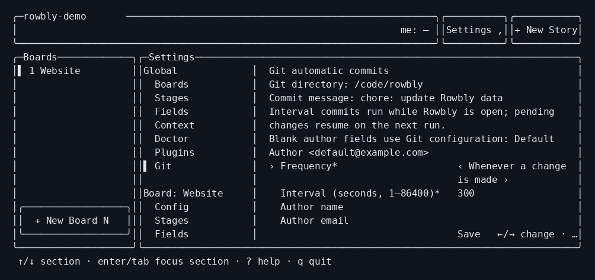

# Built-in Plugins

Rowbly ships nine Built-in Plugins. Each is off until a Data Root turns it on with `rowbly plugins enable <id>` ([Turning Plugins on and off](README.md#turning-plugins-on-and-off)). Their operations, inputs and results are in [Operations](../architecture/operations.md#built-in-plugin-operations).

| Plugin | Adds | Glossary | Decision |
| --- | --- | --- | --- |
| [Assignees](#assignees) | A roster of Assignees, and the Assignees of each Story | [`assignees/CONTEXT.md`](../../src/plugins/assignees/CONTEXT.md) | [ADR-0023](../agents/adr/0023-assignees-are-a-built-in-plugin.md) |
| [Tasks](#tasks) | Tasks inside Stories, each with its own Stage | [`tasks/CONTEXT.md`](../../src/plugins/tasks/CONTEXT.md) | [ADR-0022](../agents/adr/0022-tasks-are-a-built-in-plugin.md) |
| [Epics](#epics) | Groups of Stories across Boards, with Epic Progress | [`epics/CONTEXT.md`](../../src/plugins/epics/CONTEXT.md) | [ADR-0014](../agents/adr/0014-epics-return-as-a-built-in-plugin.md) |
| [Specs](#specs) | Markdown Spec documents for Boards and Stories | [`specs/CONTEXT.md`](../../src/plugins/specs/CONTEXT.md) | [ADR-0015](../agents/adr/0015-specs-are-markdown-files.md) |
| [Comments](#comments) | Comment Threads on Stories | [`comments/CONTEXT.md`](../../src/plugins/comments/CONTEXT.md) | [ADR-0018](../agents/adr/0018-comments-are-a-built-in-plugin.md) |
| [Story Linking](#story-linking) | Blocking relationships between Stories on the same Board | [`story-linking/CONTEXT.md`](../../src/plugins/story-linking/CONTEXT.md) | [Plugin Data, ADR-0011](../agents/adr/0011-plugin-data-is-a-bag-per-plugin.md) |
| [Attachments](#attachments) | PNG images on Stories | [`attachments/CONTEXT.md`](../../src/plugins/attachments/CONTEXT.md) | Binary journal: [ADR-0036](../agents/adr/0036-binary-plugin-files-use-the-commit-journal.md) |
| [Git](#git) | Automatic Commits and upstream synchronization | [`git/CONTEXT.md`](../../src/plugins/git/CONTEXT.md) | [ADR-0026](../agents/adr/0026-git-automatic-commits.md) |
| [Software Factory](#software-factory) | A Markdown Stage Prompt for each Stage, for agents | [`software-factory/CONTEXT.md`](../../src/plugins/software-factory/CONTEXT.md) | [ADR-0039](../agents/adr/0039-software-factory-stage-prompts.md) |

Long-text flags are `--<name> <text>`, `--<name>-file <path>` (`-` reads stdin) and `--edit` (opens `$VISUAL` or `$EDITOR`).

## Assignees

An Assignee is a person in the Data Root's roster, identified by a handle (a slug). A Story has zero or more Assignees,.

**Data**

- The roster is the file `.rowbly/plugins/assignees/roster.json`: `version` and `assignees`, a list of `{ handle, name, email? }` in the order they were added. Without the file the roster is empty.
- A Story's Assignees are its bag: `"plugins": { "assignees": { "assignees": ["ada", "sam"] } }`. A Story without Assignees has no bag.

**Commands**

```text
rowbly assignees list                                            # * marks Me
rowbly assignees add <handle> --name <name> [--email <email>]
rowbly assignees edit <handle> [--name <name>] [--email <email>]   # at least one, or exit 2; --email "" removes it
rowbly assignees remove <handle>                                 # also from every Story, with a warning
rowbly stories list … [--assignee <h|me>…]                        # Stories with any of these Assignees
rowbly stories create … [--assignee <h|me>…]
rowbly stories edit … [--assignee <h|me>… | --add-assignee <h|me>… | --remove-assignee <h|me>…]
```

**Rules**

- `--assignee` may be repeated or comma-separated. `me` means Me; it exits 2 when Me is not set.
- Added Assignees must be in the roster: otherwise `VALIDATION` (exit 2), with the valid handles in `details.validHandles`. Duplicates are dropped.
- `--assignee` replaces the list and cannot be combined with `--add-assignee` or `--remove-assignee` (exit 2).
- Adding to or removing from a Story whose Assignees bag is invalid fails with `DATA_INTEGRITY` (exit 6); `--assignee` replaces it.
- Removing an Assignee from the roster takes the handle off every Story and stamps each Story's `updatedAt`. Me is not cleared.

**TUI:** an **Assignees** section in the settings (`,`) with the roster, an Assignee's detail (Edit, Remove) and form; an Assignees multi-choice in the Story form; Assignees and "Assigned to me" in the filter of the Stories list and the board; `@handle` on a Story in the board's Stages view, its line in the board's list view and Story list rows; an Assignees row on the Story screen.

**Doctor**

- `ASSIGNEES_ROSTER_UNAVAILABLE` (error): the roster file has conflict markers, is not valid JSON, is from a newer Rowbly or fails its schema. Never fixed automatically; every roster change fails with `DATA_INTEGRITY` (exit 6) until it is fixed by hand.
- `ASSIGNEES_UNKNOWN_ASSIGNEE` (warning): a Story has Assignees that are not in the roster; `--fix` removes them and stamps the Story's `updatedAt`.
- `ASSIGNEES_UNKNOWN_ME` (warning): the local Me in Local State is not in the roster; `--fix` clears it from Local State. Global Me is not checked.

## Tasks

At Story creation, repeatable `stories create --task <name>` creates Tasks in flag order in the first effective Stage. Names are literal. New Story has a Tasks create tab with Name, Description and Stage drafts (`n` new Task). The `plugins.tasks` create input is `{ tasks: [{ name, description?, stage? }] }`; numbering starts at 1. It runs inside `stories.create`, with no separate Task operations.

A Task is a smaller unit of work inside exactly one Story, with its own name, description and Stage. It has no Assignees, Priority or Rank of its own: it belongs to the Story's Assignees. Its Task Id is its Story's Story Key, a dot and a number that is never reused in that Story (`WEB-42.3`).

**Data**

- A Story's Tasks are its bag: `"plugins": { "tasks": { "nextNumber": 4, "tasks": [ … ] } }`. The bag is kept, with `nextNumber`, when the last Task is deleted.
- Each Task has `number`, `name`, `description`, `stage`, `createdAt` and `updatedAt`. Its Task Id is derived from the Story Key, so a Story that doctor renumbers keeps its Tasks; command output and `--json` add it as `id`.
- A Task's Stage is one of its Board's effective Stages.
- Task numbers are unique within a Story. A repeated number makes the bag invalid, even if its records are identical.

**Commands**

```text
rowbly tasks list <KEY>                                                   # creation order
rowbly tasks create <KEY> --name <name> [--stage <key>] [description flags]  # default Stage: the first one
rowbly tasks show <TASK-ID>
rowbly tasks edit <TASK-ID> [--name <name>] [description flags]           # at least one, or exit 2
rowbly tasks move <TASK-ID> <stage>
rowbly tasks delete <TASK-ID>                                              # confirms; --yes when not interactive
```

Task Ids are case-insensitive (`web-42.3`). `stories show` has a Tasks row (`2/5 done`, judged by Stage Category).

**Rules**

- Moving every Task to a done Stage does not move the Story.
- `stages remove` refuses a Stage that Tasks of the affected Boards still use (`CONFLICT`, exit 4, with `details: { tasks, needsMoveTo: true }`). With `--move-to <stage>`, their Tasks move too, with a warning naming how many.
- A change to the Tasks of a Story whose Tasks bag is invalid fails with `DATA_INTEGRITY` (exit 6) and saves nothing. `tasks list` exits 6 for it, `stories show` prints `Tasks: unavailable (invalid)`, and the TUI tab says so.

**TUI:** a **Tasks** tab on the Story screen (`n` new Task, `enter` open, `m` move Stage, `e` edit, `d` delete), the Task screen and the Task form; a `✓ done/total` badge on a Story with Tasks in the board's Stages view and on its list view line.

**Doctor:** `TASKS_UNKNOWN_STAGE` (error): a Task is in a Stage its Board does not have; move it with `rowbly tasks move`. `TASKS_COUNTER_BEHIND` (warning): `nextNumber` is not above the highest Task number; `--fix` raises it.
Duplicate numbers produce `PLUGIN_DATA_INVALID` (warning) while Tasks is on; `--fix` leaves them unchanged.

## Epics

An Epic groups Stories from any Boards in the Data Root and is identified by a slug. A Story belongs to at most one Epic. Epic Progress is derived from the Stage Categories of the Epic's Stories, never stored.

**Data**

- An Epic is the file `.rowbly/plugins/epics/<epic>.json`: `version`, `id`, `name`, `description`, `closed`, `createdAt`, `updatedAt`.
- A Story's Epic is its bag: `"plugins": { "epics": { "epic": "auth" } }`.

**Commands**

```text
rowbly epics list [--closed|--all]                           # open Epics by default
rowbly epics create <id> --name <name> [description flags]
rowbly epics show <id>                                       # its Stories, grouped by Board, and Epic Progress
rowbly epics edit <id> [--name <name>] [description flags]   # at least one, or exit 2
rowbly epics close <id>
rowbly epics reopen <id>
rowbly epics delete <id>                                     # unlinks its Stories, with a warning
rowbly stories list … [--epic <id> | --no-epic]
rowbly stories create … [--epic <id>]
rowbly stories edit … [--epic <id> | --no-epic]
```

`stories list --epic <id>` takes an Epic ID (a slug); anything else is exit 2. `stories show` has an Epic row.

**TUI:** an **Epics** Plugin Sidebar beside the Board sidebar, shown and hidden with the **Epics** header button (or `\`), listing the open Epics by name after **All Epics**: picking an Epic (click, or `{`/`}`) shows only its Stories on the board, in both views, and **All Epics** shows them all again; its **+ New Epic** button opens the Epic form ([ADR-0029](../agents/adr/0029-plugin-sidebars-filter-the-board.md)); an Epics entry in the home menu; the Epic list and Epic detail with Epic Progress, where `enter` on a Story opens the Story screen and `e` edits, `c` closes or reopens and `d` deletes the Epic (on the list, the highlighted one; a right click on an Epic in the list opens a menu of those keys); an Epic select in the Story form (with `No Epic`); an Epic filter (`All Epics` is apart from "no Epic"); `◆ <Epic name>` on a Story of an Epic in the board's Stages view, its line in the board's list view and its Story list row (its Epic ID when the Epic file is missing or cannot be read); an Epic row on the Story screen.

**Errors and doctor**

- An Epic file that is corrupt or from a newer Rowbly is `DATA_INTEGRITY` (exit 6) with `details.path` and `details.problem`. The Epic list shows it as unavailable, and `epics list` warns about it.
- `EPICS_MISSING_EPIC` (warning): a Story links to an Epic file that does not exist; `--fix` unlinks it.
- `EPICS_CONFLICT_MARKERS`, `EPICS_INVALID_JSON`, `EPICS_UNSUPPORTED_VERSION`, `EPICS_SCHEMA_INVALID`, `EPICS_ID_MISMATCH`, `EPICS_UNREADABLE` (errors): an Epic file that cannot be used. Never fixed automatically.

## Specs

New Story's Specs create tab holds linked Board Specs and multiple Story Spec drafts (`n` new Story Spec), each with slug (default `spec`), title and Markdown. `stories create --story-spec <slug>=<file>` is repeatable, reads `-` as stdin at most once across all text inputs, and derives title from the first `#` heading or slug. Slugs must be unique. `--spec <slug>` still links an existing Board Spec. The create-only `storySpecs: [{ slug?, title?, text }]` input writes the files on the newly created Story in the same Change Set as all other create data. Editing keeps its flat Specs multiselect.

A Spec is a Markdown document that describes work to be done; it has no approval or Stage of its own. A **Board Spec** belongs to a Board and a **Story Spec** to one Story; each is named by a slug, unique on its Board or Story. The first `# ` heading of a Spec is its title.

**Data**

- A Board Spec is `boards/<board>/plugins/specs/<slug>.md`. A Story Spec is `boards/<board>/stories/<KEY>/plugins/specs/<slug>.md`.
- A Story has any number of Story Specs ([ADR-0025](../agents/adr/0025-a-story-has-many-story-specs.md)). The Story Spec `spec` (`spec.md`) is the one named by its Story alone, and was a Story's only Story Spec before.
- A Story's bag links it to any number of Board Specs of its own Board, by slug: `"plugins": { "specs": { "specs": ["auth", "api"] } }`.

**Commands**

```text
rowbly specs list [--board <id>]                                         # Board Specs
rowbly specs list --story <KEY>                                          # the Story's Story Specs
rowbly specs create <slug> --title <title> [--text <text>|--file <path|->|--edit] [--board <id>]
rowbly specs show <slug> [--board <id>]
rowbly specs edit <slug> [--title <title>] [--text <text>|--file <path|->|--edit] [--board <id>]
rowbly specs delete <slug> [--board <id>]                                # confirms; --yes when not interactive
rowbly specs create|show|edit|delete [slug] --story <KEY> …             # a Story Spec; the slug defaults to spec
rowbly stories create … [--spec <slug>…]
rowbly stories edit … [--spec <slug>… | --add-spec <slug>… | --remove-spec <slug>…]
rowbly stories edit … --reset-specs [--spec <slug>…]                      # replaces the stored links, even invalid ones
rowbly stories list … [--spec <slug>…]
```

`--story <KEY>` names a Story Spec, because Story Keys are case-insensitive and `web-1` is also a valid slug. With `--story`, the slug names one of the Story's Story Specs, and without it the Story Spec `spec`.

**Rules**

- Deleting a Board Spec unlinks it from every Story, with a warning, and stamps each Story's `updatedAt`.
- A Board that has Board Specs is not deleted without `--force` (exit 4), even when it has no Stories. In the TUI, a Board blocked only by its Board Specs offers a forced retry after confirmation.
- Changing the links of a Story whose Specs bag is invalid fails with `DATA_INTEGRITY` (exit 6). `--reset-specs` replaces them, alone or with `--spec`, and cannot be combined with `--add-spec` or `--remove-spec`.
- The Spec filter matches a Story that links to any selected Board Spec, and never a Story whose Specs bag is invalid.

**TUI:** a **Specs** tab on the Story screen that lists the Story's Story Specs, then the Board Specs it links to; a **Specs** multi-choice in the Story form; a **Specs** entry in the home menu that lists a Board's Board Specs; a list of Board Specs in the Board detail; a Spec filter on the Stories list and the board. In both lists `enter` (or a click) opens a Spec in the full-screen editor, which shows it rendered, and `e` opens it to edit: `tab` switches between the rendered text and the raw markdown, `ctrl+s` saves, and `esc` closes it, asking first when there are unsaved changes. `n` creates a Spec in a form (slug, title and text), and `d` deletes the highlighted Story Spec or Board Spec.

**Doctor:** `SPECS_MISSING_SPEC` (warning): a Story links to Board Specs that do not exist; `--fix` unlinks them and stamps the Story's `updatedAt`.

## Comments

A Comment is a note attached to a Story. The Comments on one Story, oldest first, are its Thread. Tasks have no Comments ([ADR-0022](../agents/adr/0022-tasks-are-a-built-in-plugin.md)).

**Data**

- A Thread is the bag of its Story: `"plugins": { "comments": { "comments": [ … ] } }`. The bag is removed with the last Comment.
- Each Comment has `id` (8 random characters), `author` (Me, or `null` when Me is not set), `body`, `createdAt` and `updatedAt`.

**Commands**

```text
rowbly comments list <KEY>
rowbly comments add <KEY> [--body <text>|--body-file <path>|--edit]   # --body-file - reads stdin
rowbly comments edit <KEY> <comment-id> [body flags]
rowbly comments delete <KEY> <comment-id>                            # confirms; --yes when not interactive
```

**Rules**

- A body is stored as given; a body that is empty or only whitespace is refused. `--body` is kept exactly; `--body-file`, stdin and `--edit` lose trailing whitespace, as every long-text flag does.
- The author is Me when the Comment is added, read on each add.
- Comment ids are unique within a Story. A repeated id makes the Thread invalid, even if its records are identical. Doctor reports `PLUGIN_DATA_INVALID` (warning) while Comments is on; `--fix` leaves it unchanged.
- `comments.add` and `comments.update` return the Comment as other Plugins' transforms left it; a transform that removes it fails the operation with `CONFLICT`.
- A change to a Thread that is stored invalid fails with `DATA_INTEGRITY` (exit 6) and saves nothing; repair it by hand, with `rowbly doctor` to find it. `comments list` exits 6 for it, `stories show` prints `Comments: unavailable (invalid)`, and the TUI tab says so.

**TUI:** a **Comments** tab on the Story screen (`n` new Comment, `e` edit, `d` delete) with the Comment form, a multi-line text box. `stories show` and the Details tab have a Comments row with the count.

## Attachments

An Attachment is a PNG image on a Story. Enable with `rowbly plugins enable attachments`.
There are no settings. Commands use the plural Plugin id: `rowbly attachments`.

- `add <KEY> <file>` reads an explicitly chosen regular file, retaining its basename as the name.
  `add <KEY> --from-clipboard` reads a clipboard PNG and names it `image-YYYYMMDD-HHMM.png` in UTC.
  Give exactly one source; both require a PNG signature and at most 10 MiB. Clipboard failures report
  their reason (`unsupported`, `no-display`, `no-image`, `too-large` or `timeout`) and save nothing.
- `list <KEY> [--json]` returns entries in insertion order. Each entry is
  `{ id, name, type, size, createdAt, createdBy }`; `type` is `image/png`, `size` is bytes,
  `createdAt` is a timestamp and `createdBy` is Me or `null`. `add` returns the added entry.
- `remove <KEY> <id>` confirms first (`--yes` when prompting is unavailable), removes the entry and
  PNG together, and returns `{ removed }`. `open <KEY> <id>` uses the platform's associated application
  (`open`, Windows `start`, or `xdg-open`); with `--json` it returns `{ opened }`.

The Story bag is `plugins.attachments: { attachments: [...] }`. Ids are unique and path-safe;
bytes live at `boards/<board>/stories/<KEY>/plugins/attachments/<id>.png`. Names are display basenames,
not storage paths. `attachments.add` and `attachments.remove` save the bag and PNG in one journaled
Change Set. Unrelated Plugin Data is kept. An invalid bag exits 6 on reads or changes and is never
replaced with an empty bag. Disabling keeps entries and files; renumbering a Story moves its PNGs.

Doctor reports `ATTACHMENTS_MISSING_FILE` (warning) for entries without a PNG; `--fix` removes only
those entries from valid bags. `ATTACHMENTS_ORPHAN_FILE` (warning) reports files without entries and
preserves their bytes, including with `--fix`, for recovery. Invalid bags receive the core
`PLUGIN_DATA_INVALID` warning and no automatic repair.

**TUI:** the **Attachments** Story tab lists names, sizes and creation dates. `n` adds a PNG by file
path, `o` opens the selected image, and `d` removes it after confirmation. Paste on any Story tab
saves immediately and shows `Attached image-YYYYMMDD-HHMM.png (412 KB)`. Story and card badges show
`📎2` using only the Story bag. On new/edit forms, pasted images stay in memory until save; the
Details tab (or edit form) shows an Attachments summary such as `2 images (612 KB)`. Pending images
are limited to 10 MiB in total. Failed saves preserve them; Escape asks before discarding them.
Story create/update inputs accept `{ images: [{ name, png }] }`, where `png` is base64. Their
transforms save all entries and PNGs in the Story's own Change Set, so cancellation saves nothing.

## Story Linking

New Story's Links create tab collects Blocks and Blocked by drafts (`n` new link). Repeatable `stories create --blocks <KEY>` and `--blocked-by <KEY>` add the same relationships at creation. All targets must exist on the same Board, otherwise creation fails with `VALIDATION` and saves nothing. The create input is `{ blocks?: [Story Key], blockedBy?: [Story Key] }`; incoming relationships update the existing blocker's bag in the same Change Set and journaled commit.

Story Linking records that a Story **blocks** another Story on the same Board. The other Story shows
**Blocked by** with the blocker's Story Key. Both directions can have any number of links, including
opposing links and cycles. These relationships do not restrict Stage changes.

**Data**

Each link lives once on its blocker: `"plugins": { "story-linking": { "blocks": ["WEB-2"] } }`.
Incoming links are derived by reading Stories on the same Board. A mutation stamps only the blocker's
`updatedAt`; its last outgoing link removes the bag. The strict bag schema rejects unknown fields,
and mutations never overwrite malformed data. Other Plugin Data is preserved.

**Commands**

```text
rowbly plugins enable story-linking
rowbly story-linking list <KEY>
rowbly story-linking add <KEY> --blocks <KEY>
rowbly story-linking add <KEY> --blocked-by <KEY>
rowbly story-linking remove <KEY> --blocks <KEY>       # confirms; --yes when not interactive
rowbly story-linking remove <KEY> --blocked-by <KEY>
```

- `add` and `remove` need exactly one direction flag. Keys are case-insensitive. Adding a link needs
  existing Stories on the same Board; cross-Board and self links are `VALIDATION` (exit 2), and a
  missing Story is `NOT_FOUND` (exit 3). Adding an existing link succeeds without changing data.
- `list --json` is an array of `{ relation, key, name, available }`, with `relation` equal to `blocks`
  or `blocked-by` relative to the requested Story. Missing targets have `name: null`, `available: false`.
  `add` and `remove` return `{ blocker, blocked }` with canonical Story Keys.
- Removing from either Story edits the same outgoing link on its blocker; no second edit is needed.
  Removing a missing link is `NOT_FOUND`. A saved outgoing link to a missing target can still be removed.
- `stories show` and the TUI Details tab show **Blocks** and **Blocked by** rows. `stories show --json`
  returns the stored Story; use `story-linking list --json` for derived incoming links.
- With the Plugin enabled, `stories.remove` removes incoming references in the same Change Set as
  the deletion. An invalid linking bag on the Board refuses the whole deletion with `DATA_INTEGRITY`
  (exit 6), so partial cleanup is never saved.
- Disabling keeps all bags and hides the commands and tab. If a target is deleted while off, the
  saved links remain until removed or repaired after re-enabling. Story Key reuse and collision
  renumbering can make old links ambiguous ([ADR-0003](../agents/adr/0003-story-keys.md)); inspect
  and correct them explicitly. The Plugin never guesses a new target for an old key.

**TUI:** a **Links** tab on the Story screen, showing the direction, Story Key and name on every row.
`↑`/`↓` selects a link; `enter` or a click opens its Story directly; `esc` returns. `/` filters rows.
`n` opens the form with **Blocks** / **Blocked by** and a Story choice limited to this Board;
`ctrl+s` adds the link. `d` removes the selected link after confirmation, from either end.
Returning from a linked Story or the form refreshes the relationships.

**Doctor:** `STORY_LINKING_INVALID_TARGET` (warning) reports missing, cross-Board and self targets;
`--fix` removes those links atomically and preserves other Plugin Data. Invalid bags produce
`PLUGIN_DATA_INVALID`, are never repaired as empty, and mutations of them fail with `DATA_INTEGRITY`.
CLI `list` also exits 6 if any linking bag on the Board is invalid, because incoming links could be
concealed. The TUI shows readable links with an explicit warning that the view may be incomplete.

## Upgrading from before Plugins

Earlier Rowbly versions kept Epics, Comments, Tasks and Assignees in core ([ADR-0008](../agents/adr/0008-no-epics.md), [ADR-0018](../agents/adr/0018-comments-are-a-built-in-plugin.md), [ADR-0022](../agents/adr/0022-tasks-are-a-built-in-plugin.md)). Rowbly has no importer for that data.

- Top-level `comments` arrays on Stories, a Story's `epicId` or `assignees`, the `assignees` roster in `rowbly.config.json`, and Epic files in `epics/*.json`: doctor reports them as `LEGACY_DATA` (warning), never saves those files and never removes the data. Any other change to such a Story drops the old fields; any save of the root config drops the old roster.
- A Story's top-level `tasks` and `nextTaskNumber`, with any Comments on those Tasks: a hard cut-off. Doctor does not report them, and core drops them the next time it saves the Story.

So **commit or back up the Data Root first**, then recreate what you need with the Assignees, Tasks, Epics and Comments Plugins.

## Git



Enable with `rowbly plugins enable git`. The Data Root must be inside a Git repository; activation outside one fails with `VALIDATION` (exit 2). An enabled Plugin loaded outside Git is reported as failed with the same explanation.

Git reacts to all saved Operations, including other Plugins' changes, and creates `chore: update Rowbly data` commits. It commits the affected Rowbly-managed paths, including deletions, but excludes Local State, lock and transaction files. Other paths and unrelated staged changes are preserved. A touched path with staged changes is refused with a warning. Changes made by hand to an affected path are included; establish a clean Data Root baseline before enabling automation. Git ignores still apply.

Reactions persist work in a queue and return before Git runs. The worker copies the selected saved files under a brief Data Root lock, then runs Git against that snapshot under a separate lock in Git's directory. Reads and edits remain available during Git work. An edit queued while a commit runs remains pending, including an edit to the same path. Rapid edits may share a commit. Command mode waits for due work outside the reaction deadline; the TUI continues after enqueueing. See ADR-0030.

Personal preferences are in `local.json` under `plugins.git`:

- `automaticCommits`: `true` (default, also when absent in older preferences) or `false`.
- `synchronization`: `{ enabled: false, intervalSeconds: 300 }` by default. Its interval is independently configurable from 1 to 86400 seconds.
- `frequency`: `change` (default) or `interval`.
- `intervalSeconds`: an integer from 1 to 86400; default 300.
- `authorName` and `authorEmail`: optional; omitted fields use effective `git config user.name` and `user.email`, including repository and global `.gitconfig` settings.

Use `rowbly git show` to inspect these preferences and defaults, including Automatic Commits On/Off (`automaticCommits` in JSON). Use `rowbly git configure --automatic-commits off` to pause locally while keeping the Plugin enabled, and `--automatic-commits on` to resume. Use `rowbly git configure --frequency interval --interval 600`, optionally with `--author-name` and `--author-email`. An empty author flag restores the Git default. In the TUI settings (`,`), **Git** appears when the Plugin is enabled and loaded and offers the same fields. Preferences take effect immediately and are never committed.

Interval mode starts the deadline with the first pending change and batches later changes without moving the deadline. Changing the configured interval adjusts that deadline from the first pending change, and deferred commits use the latest saved author preferences. No change means no commit. Pending paths and the deadline persist under Git's own directory, separate for each Data Root and worktree. Timers run only while Rowbly is alive; command mode does not wait for a future deadline. When Automatic Commits are On, the next Rowbly load resumes pending work and commits it if due. There is no daemon or flush of future interval work on exit. Turning Automatic Commits Off cancels its waiting timers and prevents queued Automatic Commits on changes, due intervals and restarts. Saved changes still add pending paths. Frequency, interval and author preferences remain saved and editable without turning Automatic Commits back On. Turning On resumes at the selected frequency, preserving the first-pending deadline (adjusted only by interval edits); an overdue interval commits immediately. Disabling the Plugin also pauses waiting work and retains the pending paths for re-enabling. An already running commit may finish; later edits remain pending.

Git failures warn after the Rowbly change has saved; the Operation still succeeds. Pending paths remain for the next run to retry. Missing author configuration, an index lock or a merge conflict can prevent a commit. Commit hooks and signing are disabled for Automatic Commits to prevent hook loops and interactive signing prompts. Automatic Commits do not push, create branches or install hooks.

Doctor repair passes are Operations too. To inspect a complete repair before the next Automatic Commit, disable Git before `doctor --fix` and re-enable it after doctor exits 0; keep other Plugins on for their checks.


### Manual header Sync

With Git enabled, `S` / **Sync** calls the shared service in explicit rebase mode, independent of both
automatic preferences. It publishes a nonempty pending Rowbly data/configuration capture before
fetching, replays linear commits onto the configured upstream with ROW-15 reconciliation during each
replay, validates and publishes recoverably, then pushes normally. No pending changes still fetches
and pushes. It preserves unrelated staged/working/untracked content and original author/date/message.
A divergent local merge commit stops with `git rebase --rebase-merges` guidance; no history is silently
dropped. Staged Rowbly ambiguity and non-Rowbly conflicts require manual handling.

The header shows `Sync…` and ignores duplicate input. A running scheduled merge finishes before a
waiting manual rebase; completion is tied to that rebase's own run identity and push. Failures keep
local work and show the cause/recovery guidance. The journal and common worker are shared with
Automatic Commits and scheduled merges; there is no stash, separate landing marker or Git under a
Data Root lock. Existing `rowbly git sync` and scheduling retain enabled merge behavior.

### Automatic Merge Conflict Resolution

This separate section in **Git** settings is Off by default. `m` opens its enable/interval form;
`e` opens Automatic Commits preferences. Save either with `ctrl+s`. **Run now** and its `r` equivalent
are disabled while Off, pending or active. The overview shows the configured upstream or prerequisite,
next deadline, active phase, last attempt/result/finish time, local commit, repair count and evidence
paths. Status refreshes while the section has focus; long results remain scrollable.

```sh
rowbly git configure --automatic-merge-resolution on --merge-interval 600
rowbly git sync
rowbly git show --json --no-prompt
rowbly git configure --automatic-merge-resolution off
```

`git configure` patches only supplied fields, merging nested synchronization preferences under the
Operation lock. An omitted author flag preserves the saved value; an explicit empty one clears it.
Neither feature's On/Off or interval changes the other's preferences. Synchronization captures pending
Rowbly data even with Automatic Commits Off. Both preferences are personal Local State, never shared.

The scheduler uses persisted fixed-delay deadlines: initial scheduling time or last attempt completion
plus the current interval. An interval edit recalculates from that anchor. Timers run anywhere in the
open TUI, without keeping settings open; one overdue attempt resumes on the next Rowbly load. Command
mode drains due/admitted work outside reactions, then exits without waiting for a future deadline.
No daemon runs while closed. Off blocks future admission, including stale timer callbacks, and disables
on-demand runs. Already admitted work may finish, including push. Host replacement, root switching
and shutdown dispose future scheduling; saved preferences, deadlines and last results remain.

An attempt fetches the configured upstream, prepares a merge in isolation, reconciles and validates
Rowbly files, publishes a recoverable local result, then pushes normally to that same upstream. It
runs without prompts or an editor. No rebase, force-push, automatic branching or hook installation is
performed. Worker serialization spans processes and linked Git worktrees; short publication gates
coordinate Rowbly reads/writes without holding a Data Root lock during Git subprocesses. Later saves
remain pending rather than being cleared by an earlier capture.

The deterministic rules are defined in [ADR-0034](../agents/adr/0034-git-synchronization-publishes-recoverably.md):

- Combine independent fields and non-overlapping Markdown hunks, even when Git could merge JSON text
  cleanly. For conflicting leaves or overlapping hunks, select by stable content/source ordering and
  retain the exact base, both alternatives, provenance and decisions in committed content-addressed
  `plugins/git/merge-evidence/` files. Evidence failure blocks publication.
- Keep edits over deletions, including edited descendants. Distinct concurrent additions keep both
  complete record/file subtrees with source-qualified Board/Story remapping; identical additions coalesce.
- Keep Configuration Cascade levels separate. Restore referenced definitions, split incompatible
  field types or relax constraints only to preserve valid retained data, recording original values.
- Registered format handlers reconcile only their own supported Plugin Data and files, including
  when their Plugin is Off. Unknown, invalid or future formats remain opaque; unsafe reconciliation
  stops with an explanation and preserves alternatives, rather than stripping or migrating them.
- Recognized current Tasks or Comments bags with repeated numbers or ids in BASE or either source
  stop the attempt before local publication or push (`CONFLICT`, exit 4). Inputs, live branch,
  index and remote stay unchanged. A future shape on another side does not hide a known duplicate.
  Distinct additions in individually valid sources still retain both records with evidence.

Unrelated staged, dirty and untracked content remains intact. Non-Rowbly conflicts, unsafe local
path overlap, staged Rowbly ambiguity, detached HEAD, missing upstream and bounded authentication or
network errors stop safely. A rejected push leaves a valid local merge and a **failed** result; the
next enabled attempt fetches and reconciles again. Interrupted durable local publication completes
before cooperating reads or writes, including when Off, without performing network work or newly
pushing. External Git and editors are outside Rowbly's coordination; unexpected changes are reported.

Run summaries persist in Git metadata per Data Root/worktree. `git show --json` returns them under
`synchronizationRun`, while `git sync --json` returns a summary directly. Required `enabled` and
`intervalSeconds` reflect current preferences; optional `branch`, `upstream` and `prerequisite`
explain setup. `requested` denotes pending work; `active` has identity, process, host, start time and
phase. `last` has `kind` (`synchronized`, `failed`, `interrupted`), message, start/finish time, optional
commit/upstream, evidence paths and repair count. Times are epoch milliseconds. An active/pending run
can coexist with an older last result; only a completed `synchronized` result proves success. A local
commit after a rejected push does not. See the [user guide](../user-guide.md#automatic-merge-conflict-resolution).


For explicit `git sync`, a completed failed attempt returns `CONFLICT` (exit 4), with the usual
JSON error on stderr and the safe run summary in `error.details.synchronizationRun`, including any
retained local commit and evidence paths. It prints no success result on stdout. An active or pending
run owned by another process returns its run summary with exit 0; this means pending, not synchronized.
`git show` remains an inspection command and can successfully display a previous failed result.

## Software Factory

A **Stage Prompt** is a Markdown file of instructions for an agent working on a Story in one Stage.
Every Stage has one place for it, Backlog and Done included, and each is on or off; all are off by
default. `rowbly software-factory stages` gives an agent every Stage of a Board with its Stage
Prompt in one call. `ROWBLY.md` stays the place for how people work with the whole Data Root; a
Stage Prompt is one Stage's instructions. A **Stage Run** records one agent's work on a Story during
its current visit to a Stage whose Stage Prompt is on, so a supervisor that watches the Board (the
`rowbly-factory` skill) does not start the same work twice and starts it again when the Story comes
back ([ADR-0040](../agents/adr/0040-stage-runs-record-the-current-visit.md)).

**Data**

- Settings are keyed by Stage key under `stagePrompts`: global ones in `rowbly.config.json`
  (`"plugins": { "software-factory": { "enabled": true, "stagePrompts": { "todo": { "enabled": true, "path": "plugins/software-factory/stage-prompts/todo.md" } } } }`),
  a Board's own in its `board.config.json` bag (`"plugins": { "software-factory": { "stagePrompts": { … } } }`).
- Files: `plugins/software-factory/stage-prompts/<key>.md` (global) and
  `boards/<board>/plugins/software-factory/stage-prompts/<key>.md` (Board). `path` is relative to the
  Data Root.
- A Board's entry for a Stage replaces the global entry for that Stage, whole; other Stages keep the
  global entry ([ADR-0039](../agents/adr/0039-software-factory-stage-prompts.md)). Global entries for
  Stages the Board does not have are not shown for it.
- A Story's Stage Run is in its bag: `"plugins": { "software-factory": { "stageRun": { "stage": "in-progress", "status": "running", "attempt": 1, "worker": "ROW-12 worker", "by": "alex", "startedAt": "…" } } }`,
  with `finishedAt` once it ends and `reason` when it failed.

**Commands**

```text
rowbly software-factory stages [--board <id>] [--level board|global]   # every Stage with its Stage Prompt
rowbly software-factory prompt show <stage> [--board <id>] [--level board|global]
rowbly software-factory prompt enable <stage> [--board <id>] [--level board|global]
rowbly software-factory prompt disable <stage> [--board <id>] [--level board|global]
rowbly software-factory prompt edit <stage> [--text <text>|--file <path|->|--edit] [--board <id>] [--level board|global]
rowbly software-factory prompt remove <stage> [--board <id>] [--level board|global]   # confirms; --yes when not interactive
rowbly software-factory runs [--board <id>]   # Stories in Stages whose Stage Prompt is on, with their Stage Runs
rowbly software-factory run start <story> --worker <name> [--retry]
rowbly software-factory run finish <story>
rowbly software-factory run fail <story> [--reason <text>]
rowbly software-factory run clear <story>
```

Writes default to the Board level (`--board`, then the current Board). `stages` and `prompt show`
show the effective Stage Prompts without `--level`, and one level alone with it.

`stages --json` returns `{ board, stagesSource, stages: [{ key, name, category, prompt }] }`, where
`prompt` is `{ enabled, configured, source, path, exists, text }`: `configured` is the saved on/off
setting, `source` is `board`, `global` or `null` (none), and `text` is the file's Markdown or `null`.

`runs --json` returns `{ board, stages, stories: [{ key, name, stage, stageRun }] }`: `stages` are the
Board's Stages whose Stage Prompt is on, `stories` every Story in them, and `stageRun` the Story's
Stage Run for its current visit or `null`. `run start`, `finish` and `fail` return
`{ key, stageRun }`; `run clear` returns `{ cleared }`.

**Rules**

- `enabled` is true only when the setting is on, `path` points inside the Plugin's folder for its
  level, and the file exists. A file that cannot be read, such as a symbolic link (which Rowbly does
  not follow), counts as missing. Agents use a Stage Prompt only when `enabled` is true.
- `enable` without a file writes a template headed with the Stage name; on a Board, it copies the
  global Stage Prompt's file for that Stage instead when that file can be read. `disable` keeps the
  file; `remove` deletes the entry and its file at that level only, so a Board falls back to the
  global entry. A file that cannot be read, such as a symbolic link, is left in place.
- `edit` creates the file and entry when there are none. A new Board entry starts with the global
  entry's on/off setting.
- `enable`, `disable` and `edit` need a Stage of that level: the global (or default) Stages for
  `--level global`, the Board's effective Stages otherwise (`NOT_FOUND`, exit 3).
- A Story has at most one Stage Run, and it counts only while the Story stays in its Stage: moving
  the Story, or changing its Stage with `stories.update`, removes it, and one recorded for another
  Stage is ignored. No history is kept.
- `run start` needs the Story's Stage to have a Stage Prompt that is on, and no Stage Run for this
  visit (`CONFLICT`, exit 4). `--retry` starts a failed one again as its next `attempt`. `by` is Me,
  or `null`. `finish` and `fail` end a running Stage Run (`CONFLICT` otherwise); `clear` removes any
  Stage Run (`NOT_FOUND`, exit 3, when there is none), so the Stage is worked again.

With Software Factory on, each Stage heading in the Board's Stages view has a clickable `✎`.
It opens that Stage's effective Stage Prompt in the fullscreen viewer, including when the prompt
is off or missing (a missing file starts with a template). `tab` or `e` switches to editing;
`ctrl+s` saves, and closing unsaved edits asks before discarding them. Saving writes the shown
Board's own Stage Prompt, preserving its on/off setting; an inherited prompt becomes a Board
entry with the global entry's setting. Use Stage Prompts in Settings to change that setting.

**TUI:** a **Stage Prompts** section in Settings (`,`) lists the current Board's Stages with their
effective Stage Prompts (`on · board`, `on · global`, `off`), or the global level. `space` turns the
highlighted Stage's prompt on or off at the shown level, `enter` reads it, `e` edits it in the
full-screen editor (`ctrl+s` saves), `d` removes the shown level's entry and its file, and `l`
switches between the Board and global levels. The Story screen shows a **Stage Run** row while the
Story has one for its current Stage, such as `running (ROW-12 worker)` or
`failed (ROW-12 worker, attempt 2): tests failed`.

**Doctor:** `SOFTWARE_FACTORY_MISSING_PROMPT` (warning): a Stage Prompt is on at either level, but its
path is not set, points outside the Plugin's folder, or its file is missing or cannot be read. There
is no fix: create the file with `prompt edit`, or turn it off.
